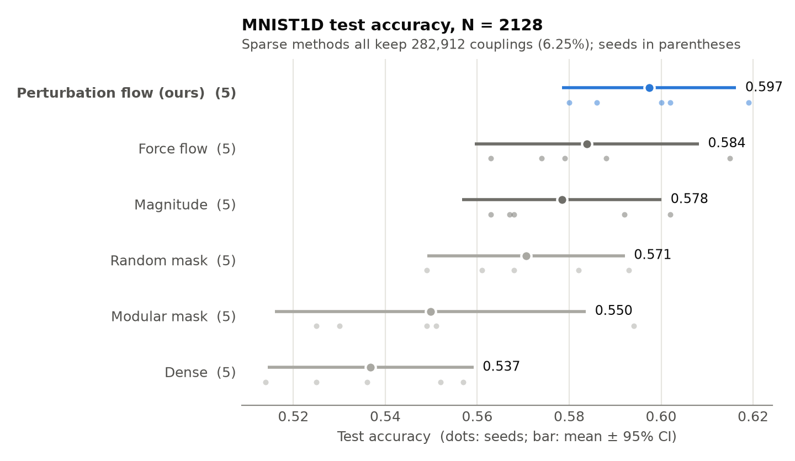

# flow-rewire

Physarum flow pruning of Kuramoto oscillator couplings, built on Unconventional AI's
[Un-0](https://github.com/unconv-ai/Un-0) release and the protocol of "Less is More".

**Full writeup: [docs/writeup.md](docs/writeup.md).**

## Result

Linearized Kuramoto dynamics is an exact physarum flow network:

- Conductance: Kᵢⱼ cos Δθ̄
- Pressure: the input-driven phase perturbation δθ

Starting dense, edges are pruned by the physarum conductivity rule driven by this
perturbation flow. On MNIST1D at N = 2128, all sparse networks keep 6.25% of the edges.

| method | test acc. (5 seeds) |
| --- | --- |
| **Perturbation-flow pruning (this work)** | **0.597 ± 0.015** |
| Gradual magnitude pruning | 0.578 ± 0.017 |
| Random mask ("Less is More") | 0.571 ± 0.017 |
| Dense | 0.537 ± 0.018 |

- **vs. the random mask:** +2.7 points paired by seed, better on 5/5 seeds, p = 0.016.
- **vs. dense:** 16× fewer coupling operations per inference.
- **Replication:** fresh seeds 5–9 are in progress.



## Layout

| Path | Contents |
| --- | --- |
| `src/flow_rewire/mnist1d_model.py` | Kuramoto classifier, Un-0 dynamics with a coupling mask |
| `src/flow_rewire/mnist1d_train.py` | Training protocol and CLI |
| `src/flow_rewire/flow.py` | Force flow and perturbation flow per edge |
| `src/flow_rewire/pruning.py` | Gradual pruning by physarum conductivity or magnitude |
| `src/flow_rewire/energy.py` | Coupling-operation proxy and measured GPU energy |
| `src/flow_rewire/figures.py` | Writeup figures from the result records |
| `docs/mnist1d_spec.md` | Protocol: specified vs. inferred, with sources |
| `results/<run>/` | Raw records, `MANIFEST.json` (commit, commands) and README per run |

The `results/` runs:

- `baseline`: dense, random and modular masks (frozen)
- `prune`: force-flow vs. magnitude pruning
- `perturb`: perturbation-flow pruning
- `replicate`: seeds 5–9

Un-0 is pinned to upstream commit `75243ca` in `pyproject.toml`.

## Usage

```bash
uv sync --group dev --group eval
uv run pytest                                          # unit tests
uv run python -m flow_rewire.mnist1d_train --hidden 2048 --sparsity 0.9375 \
    --masks perturbation_prune --seeds 0 --lrs 3e-3    # one run, ~4 min on an 8 GB laptop GPU
uv run python -m flow_rewire.figures                   # regenerate figures
```

## Earlier exploration: one-shot pruning of the CIFAR-10 checkpoint

The pipeline reproduces the released `cifar10/n1024` checkpoint at clean-FID **11.145**
(published 11.16; 50k samples, seed 42).

Post-hoc pruning without retraining was tested at 10k samples. Force flow ranked first:

| s | force flow | magnitude | random |
| --- | --- | --- | --- |
| 0.90 | 22.22 | 22.84 | 24.20 |
| 0.98 | 24.26 | 24.63 | 26.07 |

The margin over magnitude came from a single seed. Training with masks at CIFAR scale
does not fit in 8 GB, so the study moved to the MNIST1D setting of "Less is More"
(`flow_rewire.evaluate`, `flow_rewire.sweep`).

## References

- Unconventional AI. *Introducing Un-0: Generating Images with Coupled Oscillators.* 2026.
- Unconventional AI. *Less is More: Scaling Dynamics with Sparsity.* 2026.
- Cutler, H., Li, C.-H. G. *Topology That Learns.* ALIFE 2026.
- Tero, A., Kobayashi, R., Nakagaki, T. *J. Theor. Biol.* 244(4), 2007.
