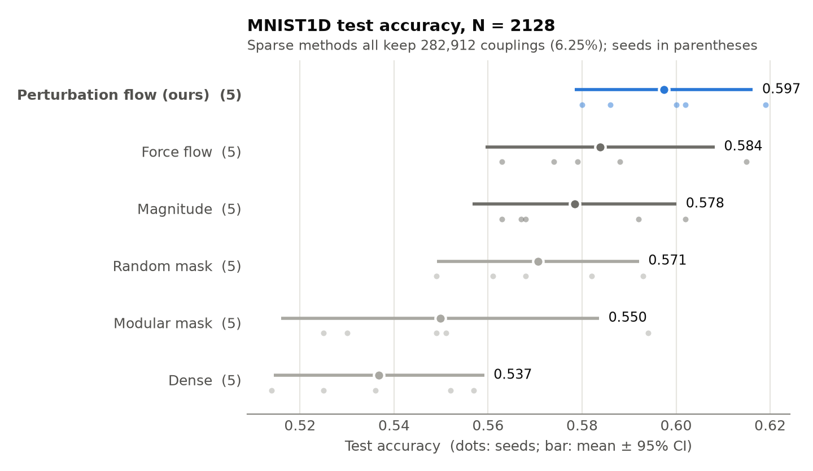
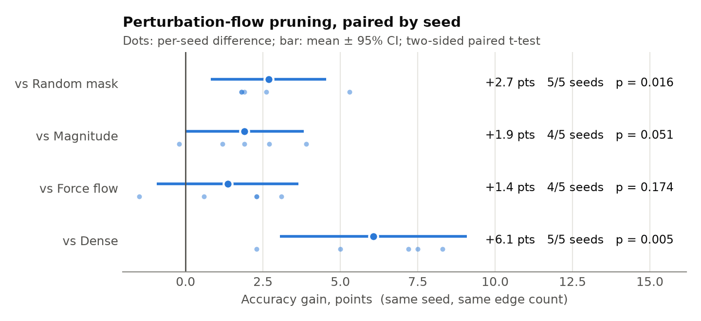
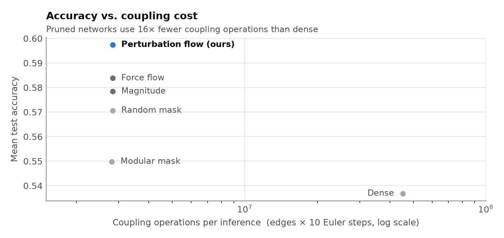

# Physarum flow pruning for Kuramoto oscillator networks

*Draft. Results cover seeds 0–4; a replication on seeds 5–9 is running (see [Replication](#replication)).*

## Summary

"Less is More" (Unconventional AI, 2026) shows that large Kuramoto oscillator networks
lose accuracy through synchronization collapse, and that **static** sparse masks (random
or modular) recover it. Those masks are chosen without reference to the dynamics.

This project chooses the mask *from* the dynamics. Linearizing Kuramoto dynamics around
the mean trajectory turns the network into an exact physarum flow network: couplings
become conductances and phase perturbations become pressures. Starting dense, edges are
pruned gradually according to the physarum conductivity rule dD/dt = |Q| − γD
(Tero et al., 2007; Cutler & Li, ALIFE 2026).

On MNIST1D at N = 2128 oscillators, with every sparse network at the same edge count
(6.25%), the protocol reproduced from "Less is More" gives:

- **0.597 ± 0.015** test accuracy, against 0.571 for the random mask of "Less is More":
  **+2.7 points, better on 5/5 seeds, p = 0.016**.
- +6.1 points over dense, with 16× fewer coupling operations per inference.
- +1.9 points over gradual magnitude pruning, the standard alternative (4/5 seeds,
  p = 0.051; not yet conclusive).

## 1. Idea: Kuramoto dynamics is a flow network

Un-0 integrates

  θ̇ᵢ = ωᵢ + Σⱼ Kᵢⱼ sin(θⱼ − θᵢ).

Let θ̄ be the batch-mean (circular) phase trajectory and δθ = θ − θ̄ one input's
deviation from it. To first order,

  δθ̇ᵢ = Σⱼ Cᵢⱼ (δθⱼ − δθᵢ),  with Cᵢⱼ = Kᵢⱼ cos(θ̄ⱼ − θ̄ᵢ).

This is Kirchhoff flow on a graph, which is the physarum model term for term:

| Physarum (Tero et al., 2007) | Linearized Kuramoto |
| --- | --- |
| conductivity Dᵢⱼ | Cᵢⱼ = Kᵢⱼ cos(θ̄ⱼ − θ̄ᵢ) |
| pressure pᵢ | δθᵢ, the input-driven phase perturbation |
| flux Qᵢⱼ = Dᵢⱼ (pⱼ − pᵢ) | Qᵢⱼ = Cᵢⱼ (δθⱼ − δθᵢ) |
| sources | input oscillators (set by the encoder) |

An edge's **perturbation flow** |Qᵢⱼ| measures how much input-dependent signal it
carries. That is the quantity a classifier needs to route from input to readout.

A first, naive mapping used the nonlinear coupling force, |Kᵢⱼ sin(θⱼ − θᵢ)|, as the flow.
It turned out to rank edges almost exactly like |Kᵢⱼ|, so it adds little over magnitude
pruning ([Section 4](#4-why-the-perturbation-form-matters)). It is kept as an ablation.

## 2. Method

Training follows the baseline recipe, except that it starts dense. Edges are removed
permanently, and the final edge count is matched per seed to that seed's random-baseline
mask.

- **Schedule.** One pruning event every 250 steps, from step 250 until 75% of training.
  The active edge count follows the cubic schedule of Zhu & Gupta (2017).
- **Measurement.** At each event, one training batch of 100 is integrated with the current
  (pruned) couplings, and non-input initial phases are shared across the batch. As a
  result, δθ reflects the inputs only. |Qᵢⱼ| is averaged over the batch and the 11 time
  points (`flow.abs_perturbation_flow`).
- **Conductivity.** Dᵢⱼ ← (1 − γ) Dᵢⱼ + Qᵢⱼ with γ = 0.5, the discrete physarum rule.
  At each event, the lowest-D active edges are removed.

Configuration: `PruneConfig` defaults in `src/flow_rewire/pruning.py`. These defaults were
set before any result and are shared by all three pruning scores.

## 3. Results

### Setup

| | |
| --- | --- |
| Task | MNIST1D, default split: 4000 train / 1000 test |
| Model | Un-0 Kuramoto classifier: 40 input, 2048 hidden, 40 readout oscillators (N = 2128). 10 Euler steps, T = 1, sin/cos readout. |
| Training | Un-0 optimizer: DecoupledAdamW, betas (0.9, 0.95), weight decay 1e-3, warmup then linear decay, gradient clip 1.0. MNIST1D reference loop: batch 100, 8000 steps. |
| Learning rate | Selected on seed 0 from {1e-3, 3e-3, 1e-2}, separately for each method, then fixed for all seeds |
| Sparsity | 93.75% (s = 1 − 2⁻⁴), 282,912 of 4.5M couplings. Modular uses Z = 16 (280,912). |
| Seeds | 0–4, paired: the same seed gives the same initialization and data order for every method |

Unspecified details were inferred from Un-0 and the MNIST1D reference trainer. Each one
is listed with its source in [`mnist1d_spec.md`](mnist1d_spec.md).

**Pipeline check.** The same codebase reproduces the released Un-0 CIFAR-10 checkpoint at
FID 11.145 (published 11.16). The MNIST1D baselines reproduce the qualitative trend of
"Less is More" Fig. 9: dense accuracy falls with N, and random sparsity recovers it at
N = 2128.

### Accuracy



| method | test acc. | train acc. | LR |
| --- | --- | --- | --- |
| **Perturbation-flow pruning** | **0.597 ± 0.015** | 0.705 ± 0.009 | 3e-3 |
| Force-flow pruning (ablation) | 0.584 ± 0.020 | 0.698 ± 0.016 | 3e-3 |
| Gradual magnitude pruning | 0.578 ± 0.017 | 0.700 ± 0.008 | 3e-3 |
| Random mask ("Less is More") | 0.571 ± 0.017 | 0.674 ± 0.016 | 1e-2 |
| Modular mask ("Less is More") | 0.550 ± 0.027 | 0.617 ± 0.016 | 1e-2 |
| Dense | 0.537 ± 0.018 | 0.599 ± 0.008 | 1e-3 |

Values are mean ± std over 5 seeds, using final accuracy at step 8000.

### Paired comparison



| perturbation-flow pruning − | per seed (points) | mean | 95% CI | p | wins |
| --- | --- | --- | --- | --- | --- |
| Random mask | +1.8, +1.9, +2.6, +1.8, +5.3 | **+2.7** | [+0.8, +4.6] | **0.016** | **5/5** |
| Magnitude pruning | −0.2, +1.2, +2.7, +1.9, +3.9 | +1.9 | [−0.02, +3.8] | 0.051 | 4/5 |
| Force-flow pruning | −1.5, +0.6, +3.1, +2.3, +2.3 | +1.4 | [−0.9, +3.7] | 0.17 | 4/5 |
| Dense | | +6.1 | [+3.0, +9.1] | 0.005 | 5/5 |

Perturbation-flow pruning is the only pruning score that beats the random mask on every
seed. Magnitude and force-flow pruning tie with random on seeds 2 and 3.

### Cost



Energy is reported two ways: a hardware-independent proxy (coupling operations) and
measured GPU energy (NVML power sampled every 50 ms and integrated, on an RTX 5060 Laptop
GPU with a 40 W limit).

| | dense | random mask | perturbation-flow pruning |
| --- | --- | --- | --- |
| Coupling ops / inference | 4.53e7 | 2.83e6 | 2.83e6 |
| Training coupling ops / sample | 4.53e7 | 2.83e6 | 1.15e7 |
| Measured training energy (kJ / run) | 9.90 ± 0.12 | 9.72 ± 0.08 | 8.66 ± 1.63 |
| Measured inference energy (mJ / sample) | 1.98 ± 0.02 | 1.90 ± 0.01 | 1.69 ± 0.23 |

- **Inference.** The pruned network costs the same as the random mask: 16× below dense.
- **Training.** Because it starts dense, training costs 4× the static mask in coupling
  operations, and still 4× below dense.
- **Measured GPU energy.** On this GPU and at this size, measured energy is dominated by
  fixed overheads and drifts between sessions. It is recorded for every run but should be
  compared only within a session. Coupling operations are the primary hardware metric.

## 4. Why the perturbation form matters

Each score was computed on the same partially trained dense model, and the top 6.25% of
edges kept under each (`results/diagnostics/scores.json`):

| | Spearman ρ with \|K\| | kept-set overlap with \|K\| | in-phase edges kept* |
| --- | --- | --- | --- |
| Force flow ⟨\|K sin Δθ\|⟩ | 0.998 | 92% | 5.8% |
| Perturbation flow | 0.815 | 50% | 8.1% |

\*Edges with cos Δθ̄ > 0.9. Uniform keeping would retain 6.25% of them.

- **Force flow is magnitude pruning in disguise.** sin Δθ is roughly independent of the
  edge, so |K| dominates the score. This explains why force flow was only marginally
  better than magnitude.
- **Perturbation flow selects a different half of the network.** It deliberately keeps
  in-phase edges, which have high conductance cos Δθ̄ and transmit input-driven
  perturbations. The naive view would prune them as "synchronized".

## 5. Limitations

- **One configuration.** N = 2128, s = 0.9375, MNIST1D only.
- **Test-split selection.** The learning rate is selected on the test split, as in the
  MNIST1D reference, which has no validation split. This applies equally to all methods.
- **Sequential design.** Perturbation flow was designed after the force-flow result. The
  design came from the analysis in Section 4, not from test accuracy, and it uses the
  same defaults. Even so, several scores have now been compared on the same split. The
  fresh-seed replication below addresses this.
- **Small dense networks.** A small dense network (N = 88) reaches 0.641 in this setup.
  The claim concerns the large-N regime, where "Less is More" documents collapse and
  sparsity is required.

## Replication

Seeds 5–9 are being run with every setting frozen (`results/replicate/`). The methods
are perturbation-flow, magnitude, random and dense, each at its learning rate already
selected on seed 0. This section will report the 10-seed paired results.

## Reproduce

```bash
uv sync --group dev --group eval
uv run pytest
results/perturb/run.sh                         # perturbation-flow pruning, ~20 min
results/replicate/run.sh                       # seeds 5-9, ~60 min
uv run python -m flow_rewire.figures           # figures in docs/figures
```

Each `results/*/MANIFEST.json` records the commit, protocol and commands used for that run.

## References

- Unconventional AI. *Introducing Un-0: Generating Images with Coupled Oscillators.* 2026.
- Unconventional AI. *Less is More: Scaling Dynamics with Sparsity.* 2026.
- Cutler, H., Li, C.-H. G. *Topology That Learns.* ALIFE 2026.
- Tero, A., Kobayashi, R., Nakagaki, T. A mathematical model for adaptive transport network
  in path finding by true slime mold. *J. Theor. Biol.* 244(4), 2007.
- Zhu, M., Gupta, S. To prune, or not to prune. arXiv:1710.01878, 2017.
- Greydanus, S. Scaling down deep learning with MNIST-1D. 2020.
